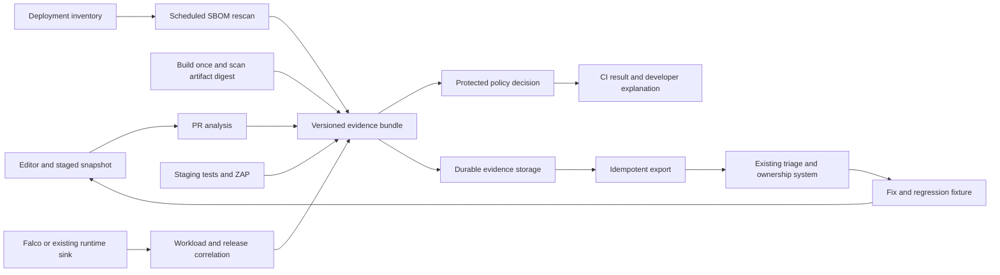

# Design: security evidence from commit to production

Status: proposed, 2026-10-17. See the [source assessment](organizational-readiness.md) for current behavior and the [sprints](devsecops-sprints.md) for delivery order. All new fields, commands and components described here are design proposals unless identified as existing. This is not a configuration or CLI reference.

## Product contract

SentinelFlow should answer four questions for every supported pipeline run:

1. What exact source, artifact or deployment was assessed, and with what coverage?
2. Did every required analysis finish with sufficiently fresh evidence?
3. Why did organizational policy allow, deny or require review?
4. Who owns each action, and what later evidence proves it resolved?

Keep existing native scanners, the adapter interface, CLI/Action distribution, fingerprints, report generation and OPA checks. Add explicit contracts around them. Rego source checks and the final organizational gate are distinct policy layers even if both eventually use OPA.

The first version remains a CLI-oriented modular application. External CI schedules scans; existing systems own issues and history. Introduce a hosted service only when a pilot demonstrates that file/object-store evidence plus an existing backend is insufficient. A service adds authentication, tenant isolation, migrations, backup, retention, availability and on-call obligations.

## Lifecycle architecture

Runtime alerts remain events with their own identity and urgency; they are not automatically CVEs or proof that a static finding is exploitable. Missing runtime alerts cannot prove a package safe.

## Pipeline profiles

| Phase | Subject and analysis | Default decision and feedback |
| --- | --- | --- |
| Developer | Actual staged snapshot; fast secrets/IaC and optional selected rules | Immediate remediation hints; local hooks supplement required CI. |
| PR | Pinned head/base identities; source analysis and dependency changes | Gate new qualifying risk, report existing debt separately; preserve full scan context for changed source/sink flows. |
| Main | Full supported repository scope | Reconcile backlog and detect vulnerabilities missed by PR scope. |
| Build/release | Immutable binary/image digest plus artifact-observed SBOM | Gate artifact risk; attest the assessed subject; publish/promote only after evidence is complete. |
| Staging | Explicit authorized URL, authenticated test context when supported | Application tests and bounded DAST; separate test failure, scan error and vulnerability decisions. |
| Production | Active deployment digests and retained SBOMs; updated advisory data | Owned alerts on newly relevant risk even without a commit. |
| Runtime | Contextual events from existing sensors | Route incidents promptly; correlate to release/owner; create regression checks where useful. |

PR-only and line-only results must never close the full repository backlog. Changes to a source, sanitizer, dependency resolution or policy can affect unchanged lines. Use change filtering for feedback relevance, with full-scope scans at main/release and explicit language-aware scope rules. The current `--diff-base` is a result filter, not a promise of reduced scan cost.

Application unit, integration, contract, performance and smoke tests stay in their existing runners. Initially link their CI result and artifact identities; do not reinterpret security JUnit as application test coverage or merge their pass/fail semantics. Expand ingestion only for a real customer need.

## Evidence and decision model

Extend `pkg/api` through a versioned additive schema and migration tests. Preserve existing JSON consumers during a documented compatibility window. Publish the schema and fixtures; avoid an untyped metadata map becoming the only definition of critical identity.

| Record | Required design fields and invariants |
| --- | --- |
| Scan envelope | Schema version, scan ID, attempt, repository/service, exact commit/base, trigger, profile ID/hash, start/end, immutable subject digest where applicable. Never store credentials in origin URLs. |
| Coverage | Requested/effective scope, discovered/scanned/skipped counts, categorized exclusions, supported and unsupported inputs, required/optional scanner list, completeness. “No applicable input” differs from “tool missing.” |
| Tool execution | Tool/version, rule-pack hash, arguments excluding credentials, accepted exit contract, status `complete/partial/failed/timed_out/not_applicable/skipped`, bounded diagnostics, retained native report reference/digest. |
| Inventory | Canonical PURL, ecosystem, resolved version, location, direct/transitive/dev evidence, inventory kind `declared/locked/resolved/artifact`, cataloger/version. Unresolved constraints remain unresolved. |
| Vulnerability context | Canonical advisory identity plus aliases, package instance, fix versions, enrichment source/time; reachability `unknown/reachable/not_observed` with tool/scope/completion evidence. |
| Observation | Scanner-specific identity and rule, location/evidence hash, confidence, first source observation. Keep raw normalized observations separate from correlations across tools. |
| Decision | Policy version/hash, trusted origin, allow/deny/review outcome, exit mapping, exact contributing observations and exceptions, rationale and evidence references. |
| Exception | Stable ID, precise scope, reason, owner, approver, approved revision, creation/expiry, evidence; retain revoked/expired history. |
| Deployment | Service/release, digest, environment, cluster/workload identity if available, owner, deployed/retired times, SBOM digest and source commit. Mutable tags are attributes, not primary identity. |
| Delivery/lifecycle | Destination/key, attempt/error/acknowledgement; first/last seen, open/accepted/resolved/reopened state, owner and SLA clock. |

A single fingerprint cannot cover source code motion, package instances, runtime occurrences and cross-tool correlation. Retain existing source fingerprints with an explicit version. Use a typed canonical serialization for future keys, include ecosystem/subject where relevant, and publish migrations before changing baseline matching. Keep observation IDs distinct from a lifecycle case ID; many observations can support one case without deleting their evidence.

Suppression becomes a decision attached to an observation. Do not remove the only retained copy before reporting or history reconciliation. Default exports omit secret values and snippets; evidence access follows retention and authorization policies. A hash of a weak secret is not encryption or a guarantee against guessing.

## Decision rules and trusted configuration

Preserve exits `0` pass, `1` policy denial, `2` configuration/tool error, `3` timeout. The machine decision also records all scanner failures and policy violations so one exit code does not hide simultaneous conditions. Proposed precedence: required deadline failure → `3`; other required incompleteness/configuration failure → `2`; complete evidence with denied policy → `1`; otherwise `0`. Optional degraded coverage can pass only when the effective protected profile explicitly permits it and the report labels it.

| Situation | Required behavior |
| --- | --- |
| Tool reports findings and then crashes | Retain findings and failure; deny a mandatory pass. |
| Head or base analysis incomplete | Delta indeterminate; no “new risk passed” conclusion. |
| Reachability tool fails after JSON preamble | Keep unknown; never convert absence to unreachable. |
| Vulnerability DB missing, stale or unsupported | Apply explicit freshness/support policy; no silent clean result. |
| Scanner disabled by PR configuration | Protected required-scanner policy rejects the weakened profile. |
| Suppression expired or wrong ecosystem/digest | Keep observation active and explain rejected exception. |
| No findings and complete coverage | Pass; this means no detected gated risk within declared capabilities. |
| Report or required export fails | Report operational failure separately; preserve local evidence for replay. |

Resolve a protected organization profile from a pinned artifact or protected CI configuration. Repository configuration can add checks and tighten thresholds; it cannot remove mandatory checks, expand exclusions, change exception authorities or widen egress. Record the merged effective policy. Policy updates are reviewed, versioned and rolled out through advisory/canary stages. Define explicit emergency bypass approval and expiry in the organization's existing change system.

The final gate may eventually be declarative policy, but avoid building a new policy DSL in sprint one. First centralize the current gate into a pure evaluator over evidence with table-driven decision tests.

## Scanner execution boundary

Extend the existing adapter rather than adding parallel execution frameworks. Each supported tool needs a tested version range, executable provenance, offline/egress behavior, accepted finding exits, malformed/partial output handling, output-size limits and deadline/process-tree cleanup. Inventory and findings survive operational errors. Required mode must fail when coverage is not complete, including output parse errors.

Do not execute repository install hooks, arbitrary build commands or discovered executables to obtain inventory. A resolved Go graph mode must document module-download/network behavior, replacements, workspace scope and its trust boundary. When safe resolution is unavailable, label the fallback inventory and let protected policy decide whether it suffices.

Offline mode requires database snapshot identity and acquisition timestamp in the scan, ecosystem support, atomic update, freshness limit, and reproducible parity fixtures against online advisory semantics. Existing offline support should be hardened, not rebuilt. Optional risk enrichment must not quietly change required KEV decisions when disabled or unavailable.

## CI delivery and supply chain

Produce evidence before applying the gate. For GitLab, use a successful report producer plus a separate required gate job so report ingestion and policy failure coexist. Validate the native SAST/dependency schemas for a declared supported GitLab version; SARIF ingestion is a separate qualified option. For GitHub, upload evidence even on scan denial and distinguish report upload failure from scanner failure. Make required versus best-effort export explicit.

Untrusted PR jobs receive read-only source permissions and no deployment/export credentials. Never run untrusted PR code under a privileged `pull_request_target` job. Where a later trusted job publishes comments/results, validate schema, provenance, run/repository identity, paths and size; treat all report strings as untrusted data. Fork-token limitations must degrade optional commenting clearly without changing the security decision.

Pin Action commit and release version independently. Verify signed checksum bundles against the expected repository/workflow identity and issuer before extracting/using a binary. Test incorrect signer and tampered archive cases. For releases: build once → scan/test → generate SBOM/provenance/signatures → verify consumer installation → publish/promote the same digests. Draft/staged release publication can support this ordering. Decide and document any advisory findings policy rather than swallowing exit `1` under a “gate” label.

## Feedback loop and shift-right delivery

Start with one existing lifecycle backend. Evaluate DefectDojo for normalized finding history and Dependency-Track for portfolio SBOM analysis; choose the first based on the pilot's dominant need. A generic API does not prove import compatibility: qualify a parser/format with empty, duplicate, reopened, suppressed and partial scans before calling it supported.

Use an exporter with a durable pending-delivery manifest in retained CI storage or an object store. A local temporary file alone is insufficient after an ephemeral runner disappears. Persist before sending; record remote acceptance; retry transient failures with backoff and bounded attempts; retain a replay/dead-letter path. Scope idempotency by destination, service/subject and observation/scan identity. An HTTP 200 can be an asynchronous acceptance, so reconcile completion where the backend requires it.

Close a finding only after a successful comparable scan of the same authoritative scope proves absence. Missing tools, delta scans, changed rule packs, retired scope and expired evidence are not fixes. Treat a retired deployment separately from remediated code. Preserve human triage and reopen when trusted new evidence warrants it. Owner mapping should use the service catalog/CODEOWNERS fallback with an explicit unowned queue.

For production, maintain active digest-to-SBOM inventory from deployment events or an existing deployment system. Run scheduled matching with fresh vulnerability data. Deduplicate a new advisory per affected service/release, route it to the owner, and escalate by agreed SLA. Keep old release SBOMs while those releases are deployed; garbage collection follows retirement and retention policy.

Later, import staging ZAP output and runtime events from an existing Falco sink. Attach deployment identity, confidence of correlation and source event reference. Unmatched events remain visible in an unassigned queue. A runtime alert may increase incident priority; lack of an alert must not suppress source/SCA risk. Incident response and production rollback remain under the existing operational authority.

Worked example: a release passes on Monday; a new advisory arrives Wednesday with no source change. Scheduled matching identifies the deployed digest and SBOM component, opens one owned case and links the original release evidence. A fix PR receives focused feedback; its rebuilt digest passes release analysis. Deployment inventory records replacement. A complete rescan verifies the fix; the old digest's case remains relevant until that digest is retired everywhere. Recurrence reopens the case without creating an uncontrolled duplicate ticket stream.

## Quality and operational acceptance

Measure detection quality separately from execution reliability. Start with supported Go/npm fixtures and representative pilot repos; publish per-rule/category counts, precision/recall methodology and known exclusions. Differential tests against specialist tools identify disagreements for investigation, not a majority-vote ground truth. Preserve adversarial fixtures and error-injection tests on trust boundaries.

Proposed pilot targets, to calibrate after a baseline week: zero false passes in the failure-injection suite; all denied findings have owner/remediation/evidence; no automatic closure from partial scans; at least 95% precision on the manually adjudicated blocking profile with sample size reported; PR p95 added wall time ≤3 minutes on a documented 2-vCPU/8-GiB fixture runner; scheduled matching completes within 24 hours; exporter fault recovery causes no duplicate lifecycle records. Report measured values, not invented success percentages. Confidence intervals and small samples limit precision claims.

Use a resource profile with bounded memory, concurrency, archive extraction and output size. Record cold/warm cache behavior and large monorepo limits. Operational dashboards can initially be backend/CI queries: coverage completion, operational error rate, queue age, DB age, owner coverage, time to first actionable feedback, exception expiry, remediation time and recurrence. Do not use raw finding-count reduction as a success metric.

Deferred: native multi-tenant control plane, custom runtime sensors, full cloud posture management, custom CVE database, broad autonomous fixes, universal test orchestration and AI triage. Revisit only after the pilot identifies a measured bottleneck.
